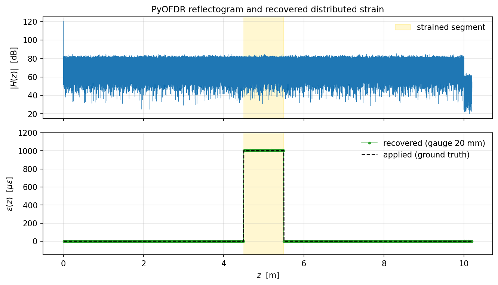

# PyOFDR
[](https://github.com/ameoli/PyOFDR/actions/workflows/tests.yml)


PyOFDR simulates optical frequency domain reflectometry (OFDR) in Python. Give it a fiber, a laser sweep and a receiver. It returns the digitized beat signal for each fiber core. You can use these traces to check a strain recovery algorithm against a known input, study receiver noise or try different sweep and sampling settings.



*1000 microstrain applied to a 1 m segment of a 10 m fiber, recovered from a single PyOFDR run by sub-spectrum cross-correlation against an unstrained baseline.*

## Status

PyOFDR runs on the NumPy backend and requires Python 3.10 or later. CI runs on Windows and Ubuntu with Python 3.10, 3.11 and 3.12. The [pipeline validation section](https://github.com/ameoli/PyOFDR/blob/main/docs/theory.md#pipeline-level-validation) gives the tested cases and their numerical tolerances.

## What's simulated
| Stage | Modelled |
|---|---|
| **Source** | linear sweep + nonlinearity + ripple, phase noise (Wiener + flicker + RW), RIN, coherence roll-off |
| **Interferometer** | main Mach-Zehnder, auxiliary MZI for k-clock resampling, optical circulator, weak FBG arrays |
| **Fiber** | Rayleigh backscatter, attenuation, macrobend loss, discrete reflectors, chromatic dispersion (GVD), stochastic n(z), multiple-scattering ghosts, MCF core-to-core crosstalk |
| **Perturbations** | static + dynamic strain (harmonic, impulsive, thermal relaxation, random vibration), Cox shear-lag coating coupling, distributed temperature with strain-T cross-sensitivity |
| **Detection** | single-ended or balanced photodetection, shot, thermal and dark-current noise, photodiode saturation and nonlinearity, Butterworth low-pass filter |
| **ADC** | clip, quantize, jitter, DNL/INL, ENOB |
| **Output** | HDF5 streaming, multi-sweep campaigns |

For equations and model limits, see the [theory guide](https://github.com/ameoli/PyOFDR/blob/main/docs/theory.md). The [configuration reference](https://github.com/ameoli/PyOFDR/blob/main/docs/config_reference.md) describes the YAML fields and units. The [architecture guide](https://github.com/ameoli/PyOFDR/blob/main/docs/architecture.md) follows a sweep through the simulation and describes the output arrays.

## Install

To install the published package from PyPI, run `python -m pip install pyofdr` in a virtual environment.

For the basic YAML configuration, notebooks and tests, clone the repository and create a virtual environment.

```bash
git clone https://github.com/ameoli/PyOFDR.git
cd PyOFDR
python -m venv .venv
```

Activate it with `.\.venv\Scripts\Activate.ps1` in PowerShell or `source .venv/bin/activate` on Linux and macOS. Then install the package from the repository root.

```bash
python -m pip install -e .
```

## Quick start

From the repository root, run the [basic configuration](https://github.com/ameoli/PyOFDR/blob/main/configs/ofdr_basic.yaml). It simulates a 10 m fiber and a 40 nm sweep in 10 ms at 200 MS/s. `info` shows the spatial spacing and Nyquist limit. `validate` checks the configuration, and `run` writes the simulated sweep to HDF5.

```bash
pyofdr info configs/ofdr_basic.yaml
pyofdr validate configs/ofdr_basic.yaml
pyofdr run configs/ofdr_basic.yaml -o out.h5
```

In `out.h5`, `sweeps/0000/digital_main` holds the ADC counts with shape `(1, 2000000)` for this configuration. To work in Python, run the same sweep in memory and compute its reflectogram. The helper uses the FFT spacing stored in the acquisition.

```python
from pyofdr.analysis.demodulation import reflectogram_from_acq
from pyofdr.core.campaign import run_campaign
from pyofdr.core.config import load_config

cfg = load_config("configs/ofdr_basic.yaml")
acq = run_campaign(cfg)[0]
H, z = reflectogram_from_acq(acq, core=0)
print(acq.digital_main.shape)  # (1, 2000000)
print(z[1] - z[0])             # FFT bin spacing in metres
```

## Examples
From the repository root, install the tutorials and start JupyterLab in the same environment:

```bash
python -m pip install -e ".[tutorials]"
python -m jupyterlab examples/
```

Open a notebook and run all cells from the beginning. The examples load the basic YAML configuration relative to the notebook directory.

- [00: Fiber signature](https://github.com/ameoli/PyOFDR/blob/main/examples/00_fiber_signature.ipynb) compares Rayleigh statistics with theory.
- [01: Reflectogram basics](https://github.com/ameoli/PyOFDR/blob/main/examples/01_reflectogram_basics.ipynb) maps ADC samples to distance and compares repeated sweeps.
- [02: Reflector loss and linewidth](https://github.com/ameoli/PyOFDR/blob/main/examples/02_reflector_loss_and_linewidth.ipynb) measures round-trip attenuation, coherence loss and peak width.
- [03: Strain recovery](https://github.com/ameoli/PyOFDR/blob/main/examples/03_strain_recovery.ipynb) recovers an imposed strain from two Rayleigh traces.
- [04: Noise budget](https://github.com/ameoli/PyOFDR/blob/main/examples/04_noise_budget.ipynb) compares predicted and measured shot, thermal and quantization noise.

## Tests

Install the test dependencies in the same environment and run the suite from the repository root.

```bash
python -m pip install -e ".[dev]"
python -m pytest tests/ -q
```

## Citing
If you use PyOFDR in published work, please cite it.

```bibtex
@software{pyofdr,
  author = {Meoli, Alessandro},
  title  = {PyOFDR: an end-to-end Python simulator for Optical Frequency Domain Reflectometry},
  year   = {2026},
  url    = {https://github.com/ameoli/PyOFDR},
}
```

## References
- Froggatt and Moore, *High-spatial-resolution distributed strain measurement in optical fiber with Rayleigh scatter*, Appl Opt 1998.
- Soller et al., *High resolution OFDR for characterization of components and assemblies*, Opt Express 2005.
- Hartog, *An Introduction to Distributed Optical Fibre Sensors*, CRC 2017.

## License
PyOFDR is distributed under the [MIT license](https://github.com/ameoli/PyOFDR/blob/main/LICENSE).

### Third-party
The laser noise generator uses [colorednoise](https://github.com/felixpatzelt/colorednoise) by Felix Patzelt. Its [MIT license](https://github.com/ameoli/PyOFDR/blob/main/LICENSES/colorednoise-MIT.txt) is included in the source and wheel distributions.

## Issues and contributions
Report bugs and feature requests in [GitHub Issues](https://github.com/ameoli/PyOFDR/issues). For simulation bugs, include the YAML configuration and the command that reproduces the problem. Pull requests are welcome.

Maintainers can follow the [release instructions](https://github.com/ameoli/PyOFDR/blob/main/docs/releasing.md) to publish a tagged version on PyPI.
